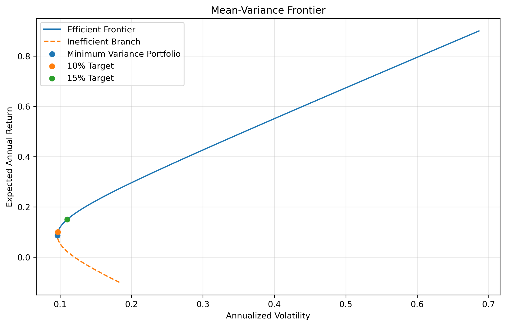
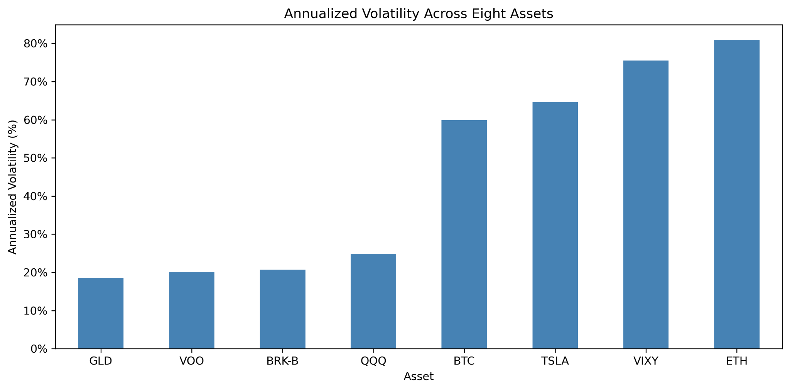

# Quantitative Risk & Portfolio Optimization

A Python-based analysis of asset risk, statistical inference, and portfolio construction using historical daily closing prices. The project applies mean-variance portfolio theory to eight assets spanning equity ETFs, an individual stock, gold, a volatility-linked ETF, and cryptocurrencies.

## Scope and methods

- **Sample:** January 1, 2020–September 29, 2026; shared trading dates across assets for multi-asset analysis.
- **Assets:** VOO, QQQ, VIXY, TSLA, BRK-B, GLD, BTC, ETH.
- **Methods:** daily simple and log returns, annualized return and volatility, covariance/correlation analysis, two-sided t-test, global minimum-variance portfolios, target-return efficient frontier, maximum-Sharpe (tangency) portfolio, and constrained optimization using KKT conditions.
- **Conventions:** 252 trading days per year; 4% annual risk-free rate.

## Selected results

| Portfolio | Expected annual return | Annual volatility | Sharpe ratio |
|---|---:|---:|---:|
| Global minimum variance | 8.65% | 9.62% | 0.4828 |
| 10% return target (shorts allowed) | 10.00% | 9.69% | 0.6193 |
| 15% return target (shorts allowed) | 15.00% | 10.99% | 1.0010 |
| Tangency portfolio | 37.19% | 25.72% | 1.2906 |
| 10% target (no short selling) | 10.00% | 9.69% | 0.6191 |

The tangency portfolio's **1.2906 Sharpe ratio is an in-sample estimate**, not a realized out-of-sample trading performance figure. The no-short-selling portfolio assigns zero weight to QQQ and ETH. Portfolio weights depend on historical estimated means and covariances and can be highly sensitive to them.

### Efficient frontier

### Asset volatility

## Reproduce the analysis

1. Download or clone the repository.
2. Install dependencies: `pip install -r requirements.txt`.
3. Open `Financial_Risk_Analysis.ipynb` using Jupyter from the repository root.
4. Run the notebook cells in order. The data file is expected at `data/daily_prices.csv` and plots save to `figures/`.

The CSV has **no header**; the notebook assigns the columns `symbol, date, open, high, low, close, volume, adjustment, source, retrieved`.

## Data and limitations

The historical price CSV was supplied for coursework. Verify any permission or redistribution restrictions before making the dataset public. Closing-price returns are not total returns adjusted for every cash distribution. All portfolio optimization results use estimated **in-sample** moments, ignore trading costs, financing frictions, and estimation uncertainty, and do not establish a real-world investment strategy.

## Repository contents

- `Financial_Risk_Analysis.ipynb` — analysis, mathematical notes, charts, and results.
- `data/daily_prices.csv` — supplied historical data (remove from public upload if redistribution is restricted).
- `figures/` — seven exported visuals.
- `requirements.txt` — Python dependencies.

This is an educational quantitative-finance analysis, not financial advice.
